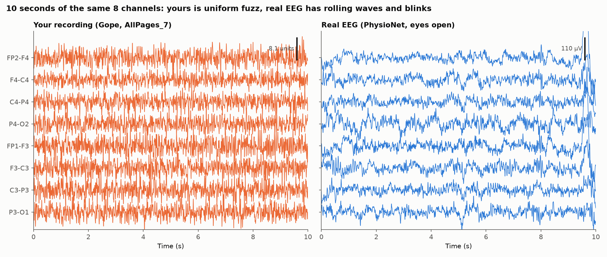
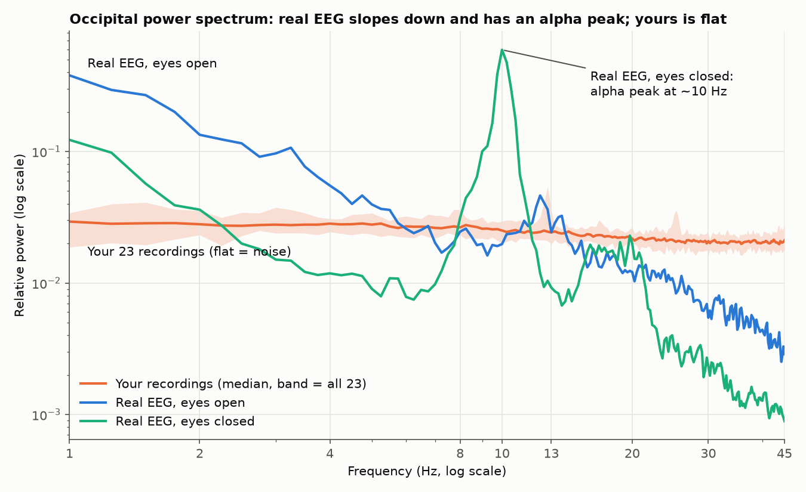
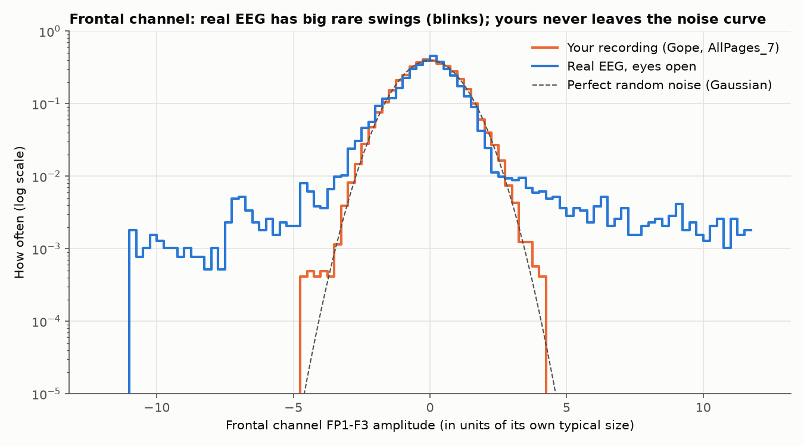
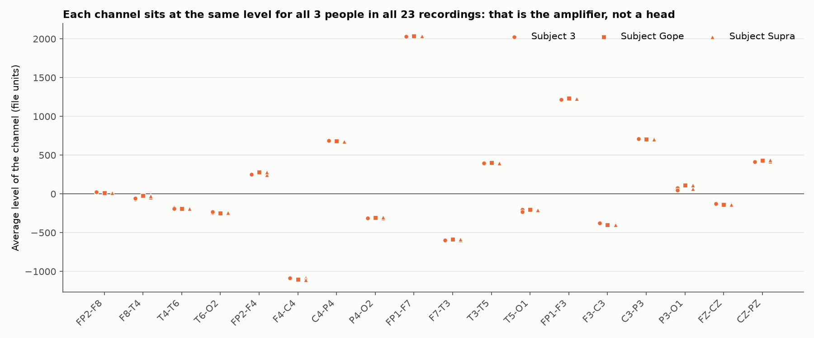
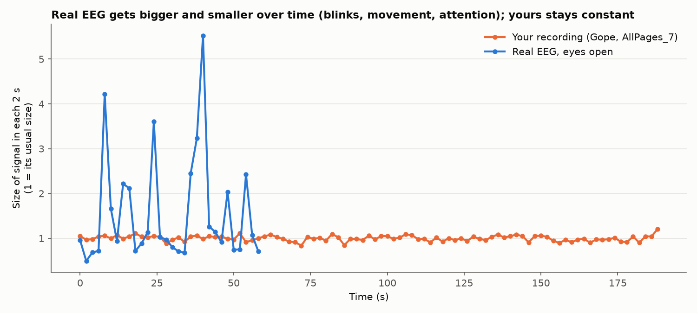

# Data Audit: what is wrong with the recordings, why, and what they should look like

Date: 2026-10-10. Scope: all 23 recordings in `Raw data/` (Subject 3: 12, Gope: 5, Supra: 6; 69.5 minutes in total),
recorded with a Medicaid NeuroMax amplifier and its own software.

For comparison, a **real EEG recording** is put through exactly the same checks: PhysioNet EEG Motor Movement/Imagery
dataset, subject 1, one minute eyes open and one minute eyes closed. It is converted to the same 18-channel bipolar layout
and the same 256 Hz rate. Reproduce with `python -I analysis/data_audit.py . <folder for the reference download>`.
Figures are in [docs/figures/data_audit/](docs/figures/data_audit/), and the numbers in `audit_stats.json` there.

---

## In one paragraph

The files are intact and readable, and the bookkeeping is right: 256 Hz, 18 channels, pages in order, no duplicates,
and channels that add up correctly. **But the signal inside them is not brain activity.** On every test, the
recordings behave like electrical noise from the amplifier itself: no slow waves, no alpha rhythm, no blinks, no change
over time, and the same per-channel levels for three different people. The most likely reason is that the electrodes
were not passing brain signals to the amplifier, or the files were exported from the wrong place in the software.
That is why every model scores 25%, the same as guessing.

---

## Part A: what is fine

| Check | Result |
|---|---|
| Files open and parse | All 23. Every page has the same 20 named series in the same order. |
| Sampling rate | **256 Hz.** A page is 2560 samples = exactly 10 s, and mains hum sits exactly at 50 Hz. |
| Pages join into one continuous recording | Yes. The jump across page boundaries is the same size as between normal samples. |
| Duplicated pages | None (0 of 417 pages). |
| Channels add up correctly | Yes. FP2→F8→T4→T6→O2 and FP2→F4→C4→P4→O2 both run from FP2 to O2, so their sums must match, and they do exactly (correlation 1.000). Same on the left side. The 18 channels really are computed from 21 electrode inputs. |
| Stimulus video timeline | Clear: 12 blocks of 9.2 s every 15 s (arrows, letters, words × left/right/forward/backward). |

So the problem is **not** the file format, the conversion code, or the sampling rate.

---

## Part B: what is wrong, why, and what it should look like

### 1. The traces are uniform fuzz

- **Yours (orange):** every channel looks the same, a fast even scribble, the whole time.
- **Real EEG (blue):** slow rolling waves, different shapes in different channels, and big deflections in the frontal
  channels when the person blinks (right edge).
- **Why it matters:** brain activity is dominated by slow waves. A signal with no slow waves isn't coming from a brain.

### 2. The power spectrum is flat

The spectrum shows how much of the signal is slow vs fast.

| | Your 23 files | Real EEG, eyes open | Real EEG, eyes closed |
|---|---|---|---|
| Slope of the spectrum (2–40 Hz) | **−0.11** (flat) | −1.17 | −1.15 |
| Slow power (1–4 Hz) ÷ fast power (13–30 Hz) | **1.2×** | 33× | 9× |
| Alpha peak at the back of the head (8–13 Hz) | **1.2×** background | 2.9× | **39×** |

- **What it should look like:** real EEG slopes down (much more slow power than fast). With eyes closed it has a tall
  "alpha" peak near 10 Hz at the back of the head. It is the most reliable feature of human EEG.
- **Yours:** flat, equal power at every frequency. That's the definition of *white noise*. Not one of 23 recordings has a
  proper alpha peak.

### 3. No blinks or other big events

- **What it should look like:** frontal channels (near the eyes) show rare, very large swings every time the person blinks
  or moves the eyes. On this plot that's the long "tails" of the blue curve, out to ±11.
- **Yours:** exactly follows the dashed "perfect random noise" curve and never goes beyond about ±4.5.
  Spikiness (excess kurtosis) is **0.0** in your files vs **16** in real EEG with eyes open. A person sitting for 3
  minutes blinks 30–60 times; none of that is in the files.

### 4. The same channel levels for every person: the clearest clue

Every channel has a constant baseline level (its "DC offset").

- **What it should look like:** the offset comes mostly from the contact between electrode, gel and skin. It changes
  every time the cap is put on, and differs between people, often by hundreds of units.
- **Yours:** each channel sits at **the same level for all three people in all 23 recordings**. For example, FP1-F7 is
  2034 ± 1.8 everywhere, and F4-C4 is −1080 to −1110 everywhere.
- **Why it matters:** offsets that never change across people and sessions come from the **amplifier's own inputs**, not
  from electrodes on a head. This is the strongest evidence that the electrodes weren't connected to the person (or to
  the amplifier), or that the recorded inputs weren't the head inputs.

### 5. The signal never changes over time

| | Yours | Real EEG, eyes open |
|---|---|---|
| How much the signal size varies from one 2 s window to the next | **6%** | 28% |

- **What it should look like:** real EEG grows and shrinks all the time with blinks, movement, attention and drowsiness.
- **Yours:** the same size from the first second to the last, in all recordings, like a machine running unattended.

### 6. Neighbouring channels behave like independent noise

| | Yours | Real EEG |
|---|---|---|
| Correlation between neighbouring channels (e.g. FP2-F8 and F8-T4) | **−0.49** | +0.33 |
| Correlation between channels far apart | about 0 | clearly non-zero |

- In a bipolar layout, two neighbouring channels share one electrode, once with a + sign and once with a − sign. If every
  electrode carried its **own independent noise**, the correlation would be exactly **−0.5**. Yours is −0.49.
- In real EEG, nearby electrodes pick up the same brain activity, which changes this pattern (here +0.33).

### 7. Very coarse values

| | Yours | Real EEG |
|---|---|---|
| Distinct values per channel | **about 25** | about 15,600 |
| Typical size of the signal | about 3 units | about 20–50 µV |

The values are whole numbers spread over only about 25 steps. If these units are µV, the signal is around 3 µV, about
the size of amplifier noise and 10 times smaller than EEG. If they're display units, the export lost almost all the
detail. Either way, they don't carry EEG.

### 8. No response to the stimulus

Detailed in `results/sanity_report.md`:
- Nothing in any file repeats every 15 s with the video blocks: 1 of 69 tests at p < 0.05, fewer than chance would give.
  This test doesn't need to know when the video started.
- A small fake brain response added to the same files **is** found by the same test. So the test works, and the files
  really contain no response.
- Every classifier (4 classical methods and the deep model) scores about 25%, the same as with shuffled labels.

### 9. Signal limited to below ~50 Hz, and filter settings that differ between sessions

- The device records 0.5–100 Hz, but the files have almost no content above ~50 Hz. Something filtered them.
- Gope's and Supra's files have **no 50 Hz mains hum at all**, while Subject 3's do. Raw EEG nearly always has mains hum.
  So a notch filter was on in some sessions and off in others, which suggests the files went through display or export
  filters.

### 10. One small exception: Subject 3, `AllPages_TEST.txt`

The only file where anything changes. From about 50 to 90 s the signal gets about 35% bigger, and a narrow peak at
12.75 Hz appears, but **only in the four left-side channels from FP1 to O1** (FP1-F3, F3-C3, C3-P3, P3-O1). Brain
activity would normally show on both sides. A change confined to one chain points to **one loose or touched electrode
or electrical pickup**, not brain activity. It does show the system can record *some* change on its inputs.

---

## Part C: most likely causes, from most to least likely

1. **The electrodes weren't delivering signal to the amplifier.** Possible reasons: the head box or cap not plugged in, the
   wrong input selected, an impedance-check or calibration mode, or no gel or poor contact. This fits everything: amplifier-
   fixed offsets, independent white noise per input, no blinks, no alpha.
2. **The files came from the wrong place in the software.** For example, a page or print export of a display or test view,
   with display filters and coarse scaling. This fits the 10 s "pages", the ~25 value levels, and filter settings that
   differ between sessions. It doesn't fully explain the identical offsets.
3. **Synthetic or demo data**, if any of the sessions were run in a demo mode. Less likely, but the TEST file's
   left-only event argues against everything being simulated.

Synchronisation between the video and the recording is **not** the main problem. The flaws above are visible without
knowing when the video started.

---

## Part D: what to do

| Step | Who | What success looks like |
|---|---|---|
| 1. Ask how the `AllPages_*.txt` files were exported | whoever ran the sessions | Name of the menu/option used |
| 2. Find the software's original recording files for one session and export them as raw data (EDF/EDF+, µV, referential montage, filters off) | operator / Medicaid support | `python -m src.sanity` shows a sloped spectrum and blinks |
| 3. Next time the device is available, record 1 min eyes open + 1 min eyes closed, check electrode impedances (< 10 kΩ) and look at the live screen for blinks before starting | operator | A clear 10 Hz alpha peak with eyes closed (like the teal line in figure 2) |
| 4. Mark the video start in every session (event key, trigger, or a note of the time) | operator | Each file's offset filled in `stimulus_offsets.json` |
| 5. Until then, develop and present the method on public datasets (SSVEP, BCI IV-2a) | us | Results on known-good data |

If step 2 gives real EEG, the existing 23 sessions may be recoverable without recording anyone again.
