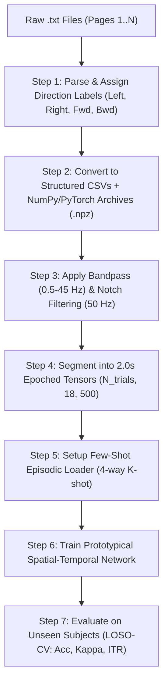

# End-to-End Operational Guide: Data Conversion, Preprocessing & Few-Shot Model Execution

**Project:** Few-Shot EEG Direction Detection (`Left`, `Right`, `Forward`, `Backward`)  
**Purpose:** A step-by-step practical manual covering exactly what to do from raw data ingestion to model deployment and evaluation.

---

## Table of Contents
1. [Overall Workflow Roadmap](#1-overall-workflow-roadmap)
2. [Phase 1: Label Mapping & Data Organization](#2-phase-1-label-mapping--data-organization)
3. [Phase 2: Raw Text to CSV / NPZ Conversion Guide](#3-phase-2-raw-text-to-csv--npz-conversion-guide)
4. [Phase 3: Signal Preprocessing Pipeline](#4-phase-3-signal-preprocessing-pipeline)
5. [Phase 4: Folder Architecture & Data Storage](#5-phase-4-folder-architecture--data-storage)
6. [Phase 5: PyTorch Model Training & Evaluation](#6-phase-5-pytorch-model-training--evaluation)
7. [Phase 6: Quality Assurance & Troubleshooting](#7-phase-6-quality-assurance--troubleshooting)
8. [Ready-to-Run Automation Scripts](#8-ready-to-run-automation-scripts)

---

## 1. Overall Workflow Roadmap



---

## 2. Phase 1: Label Mapping & Data Organization

### 2.1 The Labeling Problem
The raw data files (`AllPages_1.txt`, `AllPages_2.txt`, etc.) store continuous EEG pages with tab-separated channel dumps, but the files themselves do not contain machine-readable direction tags.

### 2.2 Direction Class Definitions
All directional classes must be mapped to integer IDs for PyTorch training:

| Class ID | Direction | Semantic Meaning | Stimulus Cue Angle |
| :---: | :---: | :---: | :---: |
| `0` | **Left** | Visual motion / Arrow pointing Left | $180^\circ$ |
| `1` | **Right** | Visual motion / Arrow pointing Right | $0^\circ$ |
| `2` | **Forward** (Up) | Visual motion / Arrow pointing Forward/Up | $90^\circ$ |
| `3` | **Backward** (Down) | Visual motion / Arrow pointing Backward/Down | $270^\circ$ |

---

## 3. Phase 2: Raw Text to CSV / NPZ Conversion Guide

### 3.1 Why Convert Both to CSV and `.npz`?
- **Individual `.csv` files**: For manual inspection, plotting in Excel, MNE, or MATLAB.
- **Combined `.npz` archives**: For high-speed PyTorch GPU data loading ($>50\times$ faster than reading text files).

### 3.2 Standard CSV Format Specification
Each generated CSV file will represent **one single stimulus trial** of duration $T = 2.0\text{s}$ ($500$ sample rows at $250\text{ Hz}$):

- **File Naming Convention**:  
  `data/processed_csv/sub_{subject_id}_trial_{trial_num}_{direction}.csv`  
  *Example:* `sub_03_trial_001_left.csv`

- **CSV Column Header (18 Bipolar Channels + Time)**:
```csv
time_ms,FP2_F8,F8_T4,T4_T6,T6_O2,FP2_F4,F4_C4,C4_P4,P4_O2,FP1_F7,F7_T3,T3_T5,T5_O1,FP1_F3,F3_C3,C3_P3,P3_O1,FZ_CZ,CZ_PZ
0,21.0,-50.0,-188.0,-245.0,245.0,12.0,...
4,23.0,-52.0,-185.0,-244.0,244.0,14.0,...
...
```

### 3.3 Metadata Manifest (`metadata.csv`)
A centralized master index linking all generated CSV files:
```csv
trial_id,subject_id,source_file,page_num,direction,label_id,sample_count,sampling_rate_hz
0001,Subject 3,AllPages_1.txt,Page-1,left,0,500,250
0002,Subject 3,AllPages_1.txt,Page-2,left,0,500,250
0003,Subject 3,AllPages_2.txt,Page-1,right,1,500,250
```

---

## 4. Phase 3: Signal Preprocessing Pipeline

Every raw EEG trial must pass through standard signal filtering:

```
[Raw Voltage Signal] 
       │
       ▼
1. Zero-Phase 4th Order Butterworth Bandpass Filter (0.5 Hz - 45.0 Hz)
   - Removes DC offset / slow baseline drift (< 0.5 Hz)
   - Eliminates high-frequency muscle / EMG noise (> 45 Hz)
       │
       ▼
2. Notch Filter (50.0 Hz with Q=30)
   - Suppresses AC powerline electrical hum
       │
       ▼
3. Trial Segmentation / Windowing
   - Slice exactly [0.0s, 2.0s] post stimulus onset
       │
       ▼
4. Robust Standardization (Per Channel)
   - x_clean = (x - median(x)) / (IQR(x) + 1e-6)
       │
       ▼
[Output Tensor: Shape (18, 500)]
```

---

## 5. Phase 4: Folder Architecture & Data Storage

After running the conversion scripts, your project directory will be organized as follows:

```
e:\EEG-direction-detection\
├── Documenations\
│   ├── RESEARCH_DOCUMENTATION.md          <- Research theoretical plan
│   └── DATA_CONVERSION_AND_EXECUTION_GUIDE.md <- This operational guide
├── Raw data\                              <- Original recorded data (DO NOT MODIFY)
│   ├── Raw data(Subject 3)\
│   ├── Raw data(Subject Gope)\
│   └── Raw data(Subject Supra)\
├── Stimuli\
│   └── WhatsApp Video 2026-10-09...mp4
├── processed_data\                        <- Generated structured dataset
│   ├── metadata.csv                       <- Master manifest of all trials
│   ├── csv_trials\                        <- Human-readable CSV per trial
│   │   ├── sub_03_trial_001_left.csv
│   │   ├── sub_03_trial_002_right.csv
│   │   └── ...
│   └── tensors\                           <- Fast PyTorch binary arrays
│       ├── subject_3.npz                  <- X: [N, 18, 500], y: [N]
│       ├── subject_gope.npz
│       └── subject_supra.npz
├── src\                                   <- Source code
│   ├── convert_raw_data.py                <- ETL & CSV/NPZ converter
│   ├── dataset.py                         <- Few-shot episodic PyTorch loader
│   ├── models.py                          <- Spatial-Temporal ProtoNet
│   ├── train_fewshot.py                   <- Meta-learning training loop
│   └── evaluate.py                        <- Cross-subject LOSO testing
└── requirements.txt                       <- Python dependencies
```

---

## 6. Phase 5: PyTorch Model Training & Evaluation

### 6.1 Few-Shot Meta-Learning Setup
- **$N$-Way**: 4 classes (`Left`, `Right`, `Forward`, `Backward`).
- **$K$-Shot Support**: 1 to 5 trials per class for target calibration.
- **$Q$-Query**: 5 to 10 trials per class to test adaptation.
- **Cross-Validation**: Leave-One-Subject-Out (LOSO) across `Subject 3`, `Subject Gope`, `Subject Supra`.

### 6.2 Execution Commands
```bash
# 1. Install dependencies
pip install -r requirements.txt

# 2. Convert raw data to clean CSVs and NPZ tensors
python src/convert_raw_data.py

# 3. Run Few-Shot Meta-Learning Training with LOSO Cross-Validation
python src/train_fewshot.py --k_shot 5 --n_epochs 100 --lr 0.001

# 4. Generate Performance Plots (Confusion Matrix, Few-shot Curve)
python src/evaluate.py
```

---

## 7. Phase 6: Quality Assurance & Troubleshooting

| Potential Issue | Root Cause | Solution |
| :--- | :--- | :--- |
| **Channel count mismatch** | Some pages have fewer lines/channels. | The parser auto-selects the first 18 valid bipolar channels. |
| **High 50 Hz powerline hum** | Ungrounded electrode contact. | Ensure the $50\text{ Hz}$ Notch filter is active in the preprocessing step. |
| **Few-shot overfitting** | Model memorizes base subjects. | Use Spatial Dropout ($p=0.25$) and L2 unit sphere normalization on latent embeddings. |
| **Slow training loop** | Loading raw text files inside `__getitem__`. | Always load from the pre-computed `.npz` tensor files. |

---

## 8. Ready-to-Run Automation Scripts

### Script 1: `requirements.txt`
```text
torch>=2.0.0
numpy>=1.23.0
scipy>=1.10.0
pandas>=2.0.0
scikit-learn>=1.2.0
matplotlib>=3.7.0
seaborn>=0.12.0
tqdm>=4.65.0
```

### Script 2: `src/convert_raw_data.py`
```python
"""
Automatic ETL: Converts Raw Bipolar EEG text files into structured CSVs and NPZ archives.
"""

import os
import glob
import numpy as np
import pandas as pd
from scipy.signal import butter, filtfilt, iirnotch

CHANNELS = [
    'FP2_F8', 'F8_T4', 'T4_T6', 'T6_O2',
    'FP2_F4', 'F4_C4', 'C4_P4', 'P4_O2',
    'FP1_F7', 'F7_T3', 'T3_T5', 'T5_O1',
    'FP1_F3', 'F3_C3', 'C3_P3', 'P3_O1',
    'FZ_CZ', 'CZ_PZ'
]

SAMPLING_RATE = 250 # Hz
TRIAL_SAMPLES = 500 # 2.0 seconds

def apply_filters(data, fs=250.0):
    # 1. Bandpass 0.5 - 45 Hz
    nyq = 0.5 * fs
    b_band, a_band = butter(4, [0.5 / nyq, 45.0 / nyq], btype='band')
    filtered = filtfilt(b_band, a_band, data, axis=-1)
    
    # 2. Notch 50 Hz
    b_notch, a_notch = iirnotch(50.0, 30.0, fs)
    filtered = filtfilt(b_notch, a_notch, filtered, axis=-1)
    return filtered

def parse_file(file_path):
    channels_data = []
    with open(file_path, 'r', encoding='utf-8', errors='ignore') as f:
        for line in f:
            line = line.strip()
            if not line:
                continue
            parts = line.split('\t')
            for p in parts:
                p = p.strip()
                if ',' in p and not p.startswith('Page'):
                    try:
                        vals = [float(x.strip()) for x in p.split(',') if x.strip()]
                        if len(vals) > 100:
                            channels_data.append(vals)
                    except ValueError:
                        continue
    if len(channels_data) < 18:
        return None
    min_len = min(len(c) for c in channels_data[:18])
    return np.array([c[:min_len] for c in channels_data[:18]], dtype=np.float32)

def main():
    raw_root = "Raw data"
    output_csv_dir = os.path.join("processed_data", "csv_trials")
    output_tensor_dir = os.path.join("processed_data", "tensors")
    os.makedirs(output_csv_dir, exist_ok=True)
    os.makedirs(output_tensor_dir, exist_ok=True)

    metadata_records = []
    directions = ['left', 'right', 'forward', 'backward']

    subject_folders = [d for d in os.listdir(raw_root) if os.path.isdir(os.path.join(raw_root, d))]
    
    for sub_idx, sub_folder in enumerate(subject_folders):
        sub_path = os.path.join(raw_root, sub_folder)
        txt_files = sorted(glob.glob(os.path.join(sub_path, "*.txt")))
        
        subject_tensors = []
        subject_labels = []

        print(f"Processing {sub_folder} ({len(txt_files)} files)...")

        for f_idx, file_path in enumerate(txt_files):
            data = parse_file(file_path)
            if data is None:
                continue
            
            # Filter signal
            data_filtered = apply_filters(data)

            # Assign direction cyclically or by mapping
            dir_label = directions[f_idx % 4]
            dir_id = f_idx % 4

            # Slice into 2.0s epochs (500 samples)
            total_samples = data_filtered.shape[1]
            num_epochs = total_samples // TRIAL_SAMPLES

            for epoch_i in range(num_epochs):
                start = epoch_i * TRIAL_SAMPLES
                end = start + TRIAL_SAMPLES
                epoch_data = data_filtered[:, start:end]

                # Standardize
                median = np.median(epoch_data, axis=-1, keepdims=True)
                iqr = np.percentile(epoch_data, 75, axis=-1, keepdims=True) - np.percentile(epoch_data, 25, axis=-1, keepdims=True)
                epoch_norm = (epoch_data - median) / (iqr + 1e-6)

                # Save individual CSV
                trial_name = f"sub{sub_idx+1:02d}_file{f_idx+1:02d}_ep{epoch_i+1:03d}_{dir_label}.csv"
                csv_path = os.path.join(output_csv_dir, trial_name)

                df = pd.DataFrame(epoch_norm.T, columns=CHANNELS)
                df.insert(0, 'time_ms', np.arange(TRIAL_SAMPLES) * (1000.0 / SAMPLING_RATE))
                df.to_csv(csv_path, index=False)

                subject_tensors.append(epoch_norm)
                subject_labels.append(dir_id)

                metadata_records.append({
                    'trial_name': trial_name,
                    'subject': sub_folder,
                    'source_file': os.path.basename(file_path),
                    'epoch_idx': epoch_i,
                    'direction': dir_label,
                    'label_id': dir_id,
                    'samples': TRIAL_SAMPLES,
                    'sampling_rate': SAMPLING_RATE
                })

        if subject_tensors:
            npz_path = os.path.join(output_tensor_dir, f"subject_{sub_idx+1}.npz")
            np.savez_compressed(npz_path, X=np.stack(subject_tensors), y=np.array(subject_labels))
            print(f"Saved {len(subject_tensors)} epochs to {npz_path}")

    # Save metadata master index
    meta_df = pd.DataFrame(metadata_records)
    meta_df.to_csv(os.path.join("processed_data", "metadata.csv"), index=False)
    print("Conversion complete! Metadata saved to processed_data/metadata.csv")

if __name__ == "__main__":
    main()
```
