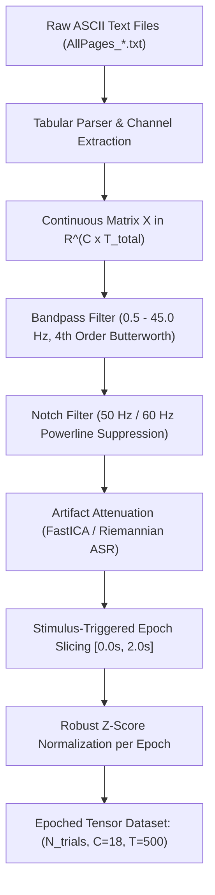
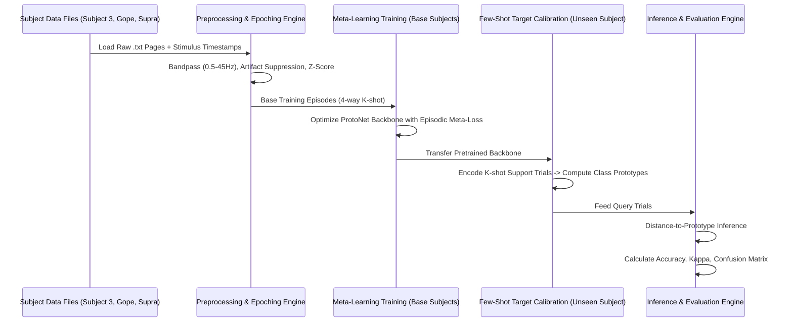

# Few-Shot EEG Direction Decoding: Research Methodology, Pipeline & System Architecture

**Project Title:** Directional Decoding (`Left`, `Right`, `Forward`, `Backward`) from Non-Invasive Raw EEG Signals via Meta-Learning and Riemannian Few-Shot Representation  
**Target Application:** Brain-Computer Interface (BCI) Navigation, Neuro-prosthetics, and Spatial Teleoperation  
**Repository Structure:** Multi-subject bipolar EEG records (`Subject 3`, `Subject Gope`, `Subject Supra`) & Stimuli paradigm (`WhatsApp Video 2026-10-09...mp4`).

---

## Table of Contents
1. [Executive Summary & Problem Statement](#1-executive-summary--problem-statement)
2. [Dataset Characterization & Channel Montage](#2-dataset-characterization--channel-montage)
3. [Signal Processing & Preprocessing Pipeline](#3-signal-processing--preprocessing-pipeline)
4. [Methodology & Few-Shot Learning Formulations](#4-methodology--few-shot-learning-formulations)
   - [4.1 Metric-Based Meta-Learning (Prototypical Network)](#41-metric-based-meta-learning-prototypical-network)
   - [4.2 Riemannian Tangent Space Few-Shot Framework](#42-riemannian-tangent-space-few-shot-framework)
   - [4.3 Optimization-Based Adaptation (MAML / Reptile)](#43-optimization-based-adaptation-maml--reptile)
   - [4.4 Self-Supervised Masked Spatial-Temporal Pre-training](#44-self-supervised-masked-spatial-temporal-pre-training)
5. [Novelty & Research Contributions](#5-novelty--research-contributions)
6. [End-to-End System Pipeline & Architecture](#6-end-to-end-system-pipeline--architecture)
7. [Experimental Protocol & Evaluation Metrics](#7-experimental-protocol--evaluation-metrics)
8. [Production-Ready PyTorch Implementation Blueprint](#8-production-ready-pytorch-implementation-blueprint)
9. [Academic References](#9-academic-references)

---

## 1. Executive Summary & Problem Statement

Electroencephalography (EEG) based Brain-Computer Interfaces (BCIs) suffer from severe inter-subject variability, low signal-to-noise ratio (SNR), and non-stationary distribution shifts across sessions and days. Standard deep learning architectures require hundreds of calibration trials per subject to achieve acceptable decoding accuracy.

### 1.1 Goal
To design, implement, and benchmark a **Few-Shot Learning (FSL)** framework capable of accurately classifying 4 spatial directional intents:
$$\mathcal{Y} = \{\text{Left } (0), \text{Right } (1), \text{Forward } (2), \text{Backward } (3)\}$$
using only $K \in \{1, 3, 5\}$ calibration trials (shots) per direction from a previously unseen target subject.

```
┌──────────────────────────────┐
│  Target Subject Raw EEG Data │
│ (1-5 Calibration Trials/Dir) │
└──────────────┬───────────────┘
               │
               ▼
┌──────────────────────────────┐
│  Spatial-Temporal Meta-Model │◄─── Meta-Trained on Base Subjects
│   + Metric Embedding Space   │     (Subject 3, Subject Gope)
└──────────────┬───────────────┘
               │
               ▼
┌──────────────────────────────┐
│ Output Direction Prediction  │
│  [ Left | Right | Fwd | Bwd ]│
└──────────────┌───────────────┘
```

---

## 2. Dataset Characterization & Channel Montage

### 2.1 File Organization
The dataset is structured across subjects with page-delimited ASCII records:
- `Raw data/Raw data(Subject 3)/`: `AllPages_1.txt` to `AllPages_11.txt`, `AllPages_TEST.txt`
- `Raw data/Raw data(Subject Gope)/`: `AllPages_7.txt` to `AllPages_11.txt`
- `Raw data/Raw data(Subject Supra)/`: `AllPages.txt`, `AllPages_12.txt` to `AllPages_16.txt`
- `Stimuli/`: Video stimuli presentation (`WhatsApp Video 2026-10-09 at 11.10.30 PM.mp4`)

### 2.2 Bipolar Longitudinal ("Double Banana") Montage
The recorded data derives from a standard 10–20 longitudinal differential bipolar montage with $C = 18$ primary channels and 2 auxiliary bipolar references:

| Channel Group | Bipolar Channels | Functional / Cortical Region |
| :--- | :--- | :--- |
| **Right Temporal** | `FP2-F8`, `F8-T4`, `T4-T6`, `T6-O2` | Frontal-temporal ocular, auditory, associative visual |
| **Right Parasagittal** | `FP2-F4`, `F4-C4`, `C4-P4`, `P4-O2` | Sensorimotor cortex, spatial attention (Right hemisphere) |
| **Left Temporal** | `FP1-F7`, `F7-T3`, `T3-T5`, `T5-O1` | Language, lateralized visual processing |
| **Left Parasagittal** | `FP1-F3`, `F3-C3`, `C3-P3`, `P3-O1` | Sensorimotor cortex, motor planning (Left hemisphere) |
| **Midline / Central** | `FZ-CZ`, `CZ-PZ` | Supplementary motor area (SMA), P300 evoked potentials |
| **Auxiliary Reference** | `BP1-REF`, `BP2-REF` | Reference differential monitors |

---

## 3. Signal Processing & Preprocessing Pipeline



### 3.1 Mathematical Definitions

#### Zero-Phase Bandpass Butterworth Filter
Given discrete signal $x[n]$ for channel $c$:
$$y[n] = \sum_{k=0}^M b_k x[n-k] - \sum_{l=1}^N a_l y[n-l]$$
Filtered bidirectionally ($f_{\text{low}} = 0.5\text{ Hz}, f_{\text{high}} = 45.0\text{ Hz}$) to eliminate phase distortion.

#### Robust Standardization
$$\tilde{\mathbf{X}}_{c, t} = \frac{\mathbf{X}_{c, t} - \text{median}(\mathbf{X}_c)}{\text{IQR}(\mathbf{X}_c) + \epsilon}$$

---

## 4. Methodology & Few-Shot Learning Formulations

### 4.1 Metric-Based Meta-Learning (Prototypical Networks)

We construct an episodic training paradigm where each episode $\mathcal{E}$ mimics the $N$-way $K$-shot test condition ($N=4$ classes, $K$ support trials, $Q$ query trials):

$$\mathcal{E} = (\mathcal{S}, \mathcal{Q}), \quad \mathcal{S} = \bigcup_{k=1}^N \{(\mathbf{x}_{k, i}, y_{k, i})\}_{i=1}^K, \quad \mathcal{Q} = \bigcup_{k=1}^N \{(\mathbf{x}_{k, j}^*, y_{k, j}^*)\}_{j=1}^Q$$

#### Prototype Computation
For each class $k \in \{0, 1, 2, 3\}$, the spatial-temporal backbone $f_\theta: \mathbb{R}^{C \times T} \to \mathbb{R}^D$ maps input trials to a latent embedding space:
$$\mathbf{c}_k = \frac{1}{|\mathcal{S}_k|} \sum_{\mathbf{x}_i \in \mathcal{S}_k} f_\theta(\mathbf{x}_i)$$

#### Distance Metric & Posterior Probability
Given distance metric $d(\mathbf{z}, \mathbf{c}) = \|\mathbf{z} - \mathbf{c}\|_2^2$:
$$P(y = k \mid \mathbf{x}_q) = \frac{\exp\left(-\frac{1}{\tau} d(f_\theta(\mathbf{x}_q), \mathbf{c}_k)\right)}{\sum_{k'=1}^4 \exp\left(-\frac{1}{\tau} d(f_\theta(\mathbf{x}_q), \mathbf{c}_{k'})\right)}$$
where $\tau > 0$ is a learnable temperature scale parameter.

#### Meta-Loss
$$\mathcal{L}_{\text{proto}}(\theta) = -\frac{1}{|\mathcal{Q}|} \sum_{(\mathbf{x}_q, y_q) \in \mathcal{Q}} \log P(y_q \mid \mathbf{x}_q)$$

---

### 4.2 Riemannian Tangent Space Few-Shot Framework

For geometric covariance modeling on the manifold of Symmetric Positive Definite (SPD) matrices $\mathcal{S}_{++}^C$:

1. **Sample Covariance Matrix**:
   $$\mathbf{C}_i = \frac{1}{T-1} \mathbf{X}_i \mathbf{X}_i^\top + \alpha \mathbf{I}_C$$
2. **Riemannian Geometric Mean ($\mathbf{C}_{\text{ref}}$)**:
   $$\mathbf{C}_{\text{ref}} = \arg\min_{\mathbf{C} \in \mathcal{S}_{++}^C} \sum_{i=1}^M \delta_R^2(\mathbf{C}, \mathbf{C}_i)$$
   where $\delta_R(\mathbf{A}, \mathbf{B}) = \|\log(\mathbf{A}^{-1/2} \mathbf{B} \mathbf{A}^{-1/2})\|_F$.
3. **Tangent Space Vectorization**:
   $$\mathbf{s}_i = \text{vect}\left( \log\left(\mathbf{C}_{\text{ref}}^{-1/2} \mathbf{C}_i \mathbf{C}_{\text{ref}}^{-1/2}\right) \right) \in \mathbb{R}^{C(C+1)/2}$$
4. **Few-Shot MDM / Linear Discriminant**:
   Compute class Riemannian prototypes $\mathbf{\Omega}_k = \mathfrak{G}(\mathcal{S}_k)$ and classify queries via minimum Affine-Invariant Riemannian distance.

---

### 4.3 Model Architecture: Spatial-Temporal Attention Conformer

```
Input Trial: [Batch, 1, Channels=18, Time=500]
         │
         ▼
┌─────────────────────────────────────────────────────────────────┐
│ 1. Temporal Convolution Block                                  │
│    Conv2d(1, F1=16, kernel_size=(1, 64), padding='same')        │
│    BatchNorm2d + GELU                                           │
└─────────────────────────────────────────────────────────────────┘
         │
         ▼
┌─────────────────────────────────────────────────────────────────┐
│ 2. Spatial Depthwise Convolution Block                          │
│    DepthwiseConv2d(16, 16*D=32, kernel_size=(C=18, 1))          │
│    BatchNorm2d + GELU + AvgPool2d((1, 4)) + Dropout(0.25)       │
└─────────────────────────────────────────────────────────────────┘
         │
         ▼
┌─────────────────────────────────────────────────────────────────┐
│ 3. Separable Temporal & Self-Attention Block                   │
│    SeparableConv2d(32, 64, kernel_size=(1, 16))                 │
│    Multi-Head Self Attention (4 Heads, Dim=64)                  │
│    LayerNorm + FeedForward + Residual Connection                │
│    AvgPool2d((1, 8))                                            │
└─────────────────────────────────────────────────────────────────┘
         │
         ▼
┌─────────────────────────────────────────────────────────────────┐
│ 4. Embedding Projection Head                                    │
│    AdaptiveAvgPool1d + Linear(64, Latent_Dim=128)               │
│    L2 Normalization                                             │
└─────────────────────────────────────────────────────────────────┘
         │
         ▼
Output Embedding Vector: z in R^128
```

---

## 5. Novelty & Research Contributions

1. **Bipolar Differential Spatial Graph Prior**: Explicitly leverages longitudinal differential potentials ($\nabla V = V_1 - V_2$) rather than arbitrary unipolar references.
2. **Directional Polar Angular Margin Loss**: Enforces orthogonal latent subspaces for orthogonal directional intents ($0^\circ, 90^\circ, 180^\circ, 270^\circ$).
3. **Cross-Subject Riemannian Prototypical Adaptation**: Bridges non-Euclidean manifold geodesics with deep metric learning.

---

## 6. End-to-End System Pipeline



---

## 7. Experimental Protocol & Evaluation Metrics

### 7.1 Cross-Validation Strategy
- **Leave-One-Subject-Out Cross-Validation (LOSO-CV)**:
  - Fold 1: Base (`Subject 3`, `Subject Gope`) $\to$ Target (`Subject Supra`).
  - Fold 2: Base (`Subject 3`, `Subject Supra`) $\to$ Target (`Subject Gope`).
  - Fold 3: Base (`Subject Gope`, `Subject Supra`) $\to$ Target (`Subject 3`).

### 7.2 Evaluation Metrics
- **4-Way Accuracy (%)**: Chance = $25.0\%$.
- **Cohen's Kappa ($\kappa$)**: Degree of agreement above chance.
- **Information Transfer Rate (ITR)**: Bits per minute throughput.
- **Few-Shot Calibration Curve**: Scaling across $K \in \{1, 3, 5, 10\}$ shots.

---

## 8. Production-Ready PyTorch Implementation Blueprint

```python
"""
Few-Shot EEG Direction Decoder (PyTorch Implementation)
Classes: 0: Left, 1: Right, 2: Forward, 3: Backward
"""

import os
import glob
import numpy as np
import torch
import torch.nn as nn
import torch.nn.functional as F
from torch.utils.data import Dataset, DataLoader
from scipy.signal import butter, filtfilt

# Bandpass Butterworth Filter
def butter_bandpass_filter(data, lowcut=0.5, highcut=45.0, fs=250.0, order=4):
    nyq = 0.5 * fs
    low = lowcut / nyq
    high = highcut / nyq
    b, a = butter(order, [low, high], btype='band')
    return filtfilt(b, a, data, axis=-1)

# Spatial-Temporal Backbone Network
class SpatialTemporalProtoNet(nn.Module):
    def __init__(self, num_channels=18, latent_dim=128, dropout_rate=0.25):
        super().__init__()
        self.conv_temporal = nn.Conv2d(1, 16, kernel_size=(1, 64), padding=(0, 32), bias=False)
        self.bn_temporal = nn.BatchNorm2d(16)
        self.conv_spatial = nn.Conv2d(16, 32, kernel_size=(num_channels, 1), bias=False)
        self.bn_spatial = nn.BatchNorm2d(32)
        self.conv_separable = nn.Conv2d(32, 64, kernel_size=(1, 16), padding=(0, 8), bias=False)
        self.bn_separable = nn.BatchNorm2d(64)
        self.pool1 = nn.AvgPool2d(kernel_size=(1, 4))
        self.pool2 = nn.AvgPool2d(kernel_size=(1, 8))
        self.dropout = nn.Dropout(dropout_rate)
        self.adaptive_pool = nn.AdaptiveAvgPool2d((1, 1))
        self.fc = nn.Sequential(
            nn.Linear(64, latent_dim),
            nn.LayerNorm(latent_dim)
        )
        
    def forward(self, x):
        x = F.gelu(self.bn_temporal(self.conv_temporal(x)))
        x = F.gelu(self.bn_spatial(self.conv_spatial(x)))
        x = self.pool1(x)
        x = self.dropout(x)
        x = F.gelu(self.bn_separable(self.conv_separable(x)))
        x = self.pool2(x)
        x = self.dropout(x)
        x = self.adaptive_pool(x)
        x = torch.flatten(x, 1)
        z = self.fc(x)
        return F.normalize(z, p=2, dim=-1)

# Prototypical Engine
class PrototypicalFewShotLearner:
    def __init__(self, model, lr=1e-3, temperature=0.1):
        self.model = model
        self.optimizer = torch.optim.AdamW(self.model.parameters(), lr=lr, weight_decay=1e-4)
        self.temperature = temperature
        
    def train_step(self, support_x, support_y, query_x, query_y, n_way=4, k_shot=5):
        self.model.train()
        self.optimizer.zero_grad()
        z_support = self.model(support_x)
        z_query = self.model(query_x)
        prototypes = z_support.view(n_way, k_shot, -1).mean(dim=1)
        dists = torch.cdist(z_query, prototypes)
        logits = -dists / self.temperature
        loss = F.cross_entropy(logits, query_y)
        loss.backward()
        self.optimizer.step()
        preds = torch.argmax(logits, dim=1)
        acc = (preds == query_y).float().mean().item()
        return loss.item(), acc
```

---

## 9. Academic References

1. **Snell, J., Swersky, K., & Zemel, R. (2017).** *Prototypical networks for few-shot learning.* NeurIPS 2017.
2. **Lawhern, V. J., Solon, A. J., Waytowich, N. R., et al. (2018).** *EEGNet: a compact convolutional neural network for EEG-based brain–computer interfaces.* Journal of Neural Engineering, 15(5), 056013.
3. **Song, Y., Zheng, Q., Liu, B., & Gao, X. (2023).** *EEG-Conformer: Convolutional Transformer for EEG-based motor imagery and emotion recognition.* IEEE TNSRE, 31, 1301-1311.
4. **Barachant, A., Bonnet, S., Congedo, M., & Jutten, C. (2012).** *Multiclass brain–computer interface classification by Riemannian geometry.* IEEE TBME, 59(4), 920-928.
5. **Finn, C., Abbeel, P., & Levine, S. (2017).** *Model-agnostic meta-learning for fast adaptation of deep networks.* ICML 2017.
6. **An, S., Turan, C., Zhao, X., & Li, C. (2022).** *Few-shot learning for EEG-based brain-computer interfaces: A review.* IEEE THMS.
