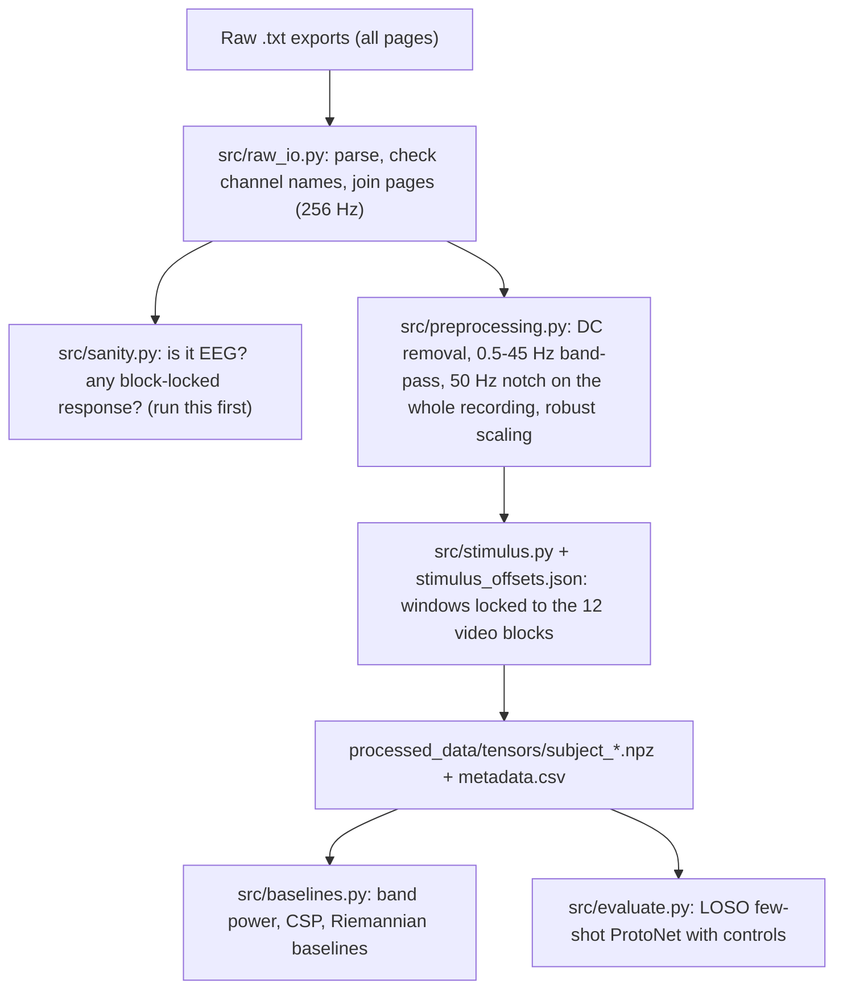

# Data Conversion and Execution Guide

How raw recordings become labelled epochs, how to check the data is valid, and how to run the models.
Updated 2026-10-10 to match the code. The history of the changes is in [WORKLOG.md](../WORKLOG.md).

> **Read first.** The current recordings fail every data-validity check (`python -m src.sanity`). They have a
> flat spectrum, Gaussian amplitudes, no blinks and no response time-locked to the stimulus. Decoding results on them
> are at chance and should not be reported as findings. Section 6 lists what is needed from the recording side.

---

## 1. Workflow



## 2. Raw file format

Each `.txt` file is one recording, which is one viewing of the stimulus video. It is a single line of tab-separated tokens:

```
Page-1  FP2- F8  v,v,v,...,  F8 - T4  v,v,v,...,  ...  BP1- REF  v,...,  BP2- REF  v,...,  Page-2 ...
```

- Each page holds 20 named series of **2560 samples = 10.0 s at 256 Hz**. Each series ends with a trailing comma.
- The 18 EEG channels are a longitudinal bipolar ("double banana") montage. `BP1-REF` and `BP2-REF` are constant auxiliary inputs and are dropped.
- Pages are consecutive in time and are concatenated. Recordings last 170–220 s.
- The parser raises `RawFormatError` on any structural problem. It never skips values silently.

## 3. Labels: the stimulus timeline

The files have no event markers. Labels come from the video in `Stimuli/`. Its timeline was verified frame by frame:

| Video time | Content |
|---|---|
| 0.5–1.5 s | title card |
| 4.2 + 15·i s (i = 0..11), 9.2 s each | stimulus blocks |
| 5.8 s between blocks | blank white screen |

| Blocks 1–4 | Blocks 5–8 | Blocks 9–12 |
|---|---|---|
| ← → ↑ ↓ (arrows) | L R F B (letters) | LEFT RIGHT FORWARD BACKWARD (words) |

Class ids: `0 left`, `1 right`, `2 forward`, `3 backward`.

**Offsets.** `stimulus_offsets.json` gives, for each file, the recording time at which the video started:
recording time = video time + offset. All offsets are currently **0.0 and unverified**. A 170 s recording cannot hold the whole 180 s video, so they are wrong for at least some files. Enter measured offsets there, then rerun the conversion.

**Windows.** Each stimulus block gives 7 windows of 2.0 s (512 samples), starting at onset + 0.5 s with a 1 s stride. Each blank gap gives 2 windows labelled `-1`. These are used only by the sanity checks.

## 4. Preprocessing

Applied to each **whole recording** before epoching, so filter edge effects stay at the recording ends:

1. Remove each channel's DC offset.
2. 4th-order Butterworth band-pass, 0.5–45 Hz, zero-phase second-order sections.
3. 50 Hz notch (Q = 30).
4. Robust scaling per channel, using the recording's median and IQR.
5. Artifact flags: any channel > 12 robust units, or a flat channel. Flagged windows are kept in the NPZ with `bad=True` and skipped by the dataset.
6. Optional at load time: Euclidean alignment per recording (`EEGSubjectDataset(..., alignment='euclidean')`).

For real-time use, `CausalPreprocessor` applies the same filters causally (no look-ahead).

## 5. Outputs

```
processed_data/
├── metadata.csv          one row per window: subject, file, offset_s, start_s, kind, block, format, label, bad
├── tensors/
│   ├── subject_3.npz     X [N,18,512], y, is_stim, block, fmt, file_idx, start_s, bad,
│   ├── subject_gope.npz  files, file_offsets_s, file_durations_s, subject, fs, channels
│   └── subject_supra.npz
└── csv_trials/           only with --csv
```

`processed_data/`, `checkpoints/` and `results/` are generated and not tracked by git.

## 6. Commands

```bash
python -m venv .venv && .venv/Scripts/pip install -r requirements.txt   # Python >= 3.10

python -m src.sanity                       # data-validity checks  -> results/sanity_report.md
python -m src.convert_raw_data [--csv]     # raw -> NPZ            -> processed_data/
python -m src.baselines                    # classical baselines   -> results/baselines.md
python -m src.evaluate --shots 1 3 5 10    # LOSO few-shot ProtoNet -> results/loso_*.md, plots, checkpoints/
python -m src.train_fewshot                # train on all subjects -> checkpoints/protonet_spatial_temporal.pth
python run_pipeline.py                     # all of the above in order
python -m pytest tests                     # 37 tests
```

## 7. Evaluation rules

- Never sample with replacement. Support and query windows always come from different stimulus blocks.
- Few-shot evaluation: each target recording takes a turn as the calibration session (K windows per class), and every window of the target's *other* recordings is tested.
- Every accuracy is reported with a 95% CI from resampling whole blocks, and a block-label permutation p-value.
- Every LOSO fold also trains a shuffled-label control model. A result only counts if it beats chance **and** the control.
- Classical baselines are always run next to the deep model.

## 8. What the data needs before decoding can work

These can't be fixed in code:

1. **Confirm the export.** Check the gain, units and channel selection in the acquisition software. Each channel has only ~24 distinct values and no 1/f spectrum, which looks like amplifier noise or a wrong export. Re-export in µV at full resolution.
2. **Record a known effect first.** One minute eyes open vs eyes closed should give strong occipital alpha. If `python -m src.sanity` can't see it, the setup is not recording EEG.
3. **Synchronise.** Use a photodiode on a screen corner, or an event marker sent to the amplifier at each block onset. Or at least note when the video was started relative to the recording, for every file.
4. **Use the original stimulus file** instead of the WhatsApp re-encode, which has a variable frame rate.
5. **More subjects.** LOSO with 3 subjects trains each model on 2.

## 9. Troubleshooting

| Symptom | Cause / fix |
|---|---|
| `RawFormatError: channels [...] != expected` | Different montage or channel order in the export. Update `CHANNELS` in `src/config.py` only if the montage really differs. |
| `RawFormatError: non-numeric sample` | Corrupt export. Re-export the file. Values are never silently dropped. |
| `No subject_*.npz files` | Run `python -m src.convert_raw_data`. |
| Few windows for one class | Recordings shorter than 180 s cut off the last blocks (backward), or offsets push blocks outside the recording. |
| All accuracies ≈ 25% with p > 0.05 | Expected with the current data. Check `results/sanity_report.md`. |
